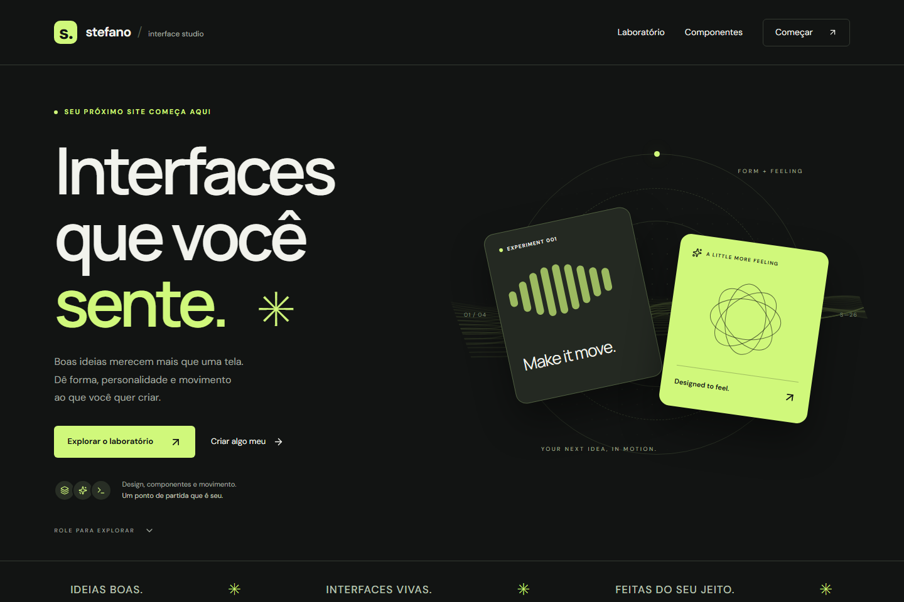

# UI-UX-Stefano

**Kit de interfaces interativas com React, TypeScript e Motion.**



**Aplicação de portfólio:** interfaces para produtos e ferramentas, componentes reutilizáveis e controle de animações. A integração e as adaptações deste kit preservam os créditos das bibliotecas e componentes de terceiros em [THIRD_PARTY_NOTICES.md](THIRD_PARTY_NOTICES.md).

Uma base reutilizável para criar sites com design, componentes e animações.
Inclui uma demonstração de estúdio com laboratório interativo, troca de cores,
controle de duração, modo de movimento reduzido e prompt inicial copiável.

## Começar no Windows

Requer Node.js 22.12+ (validado com 24.21.0).

```powershell
git clone https://github.com/MatheusSBCastro/UI-UX-Stefano.git
cd UI-UX-Stefano
npm.cmd ci --ignore-scripts
npm.cmd run dev
```

Abra **http://127.0.0.1:5174/**. Use Ctrl+C no terminal para desligar.
Para compilar: `npm.cmd run build`. Os arquivos estáticos saem em `dist/`.
Para conferir produção: `npm.cmd run preview` e abra http://127.0.0.1:4174/.

## As quatro peças

| Peça | Como está integrada |
| --- | --- |
| Claude Code | `CLAUDE.md` e descoberta da skill em `.claude/skills/`; o agente é instalado e autenticado separadamente. |
| UI UX Pro Max | Skill upstream completa em `.agents/skills/`, com wrapper `npm run design`. |
| 21st.dev | Background Paths e Attract Button da Kokonut UI, publicados no catálogo; originais e adaptações creditados. |
| Motion | Dependência `motion`, com imports de `motion/react`, utilizada no site e nos componentes. |

React + TypeScript + Vite + Tailwind CSS 4 compõem a aplicação. Dependências
resolvidas estão fixadas em `package.json` e `package-lock.json`.

## Usar a skill de design

Python 3 é necessário somente para as buscas da skill, não para rodar o site.
Nesta máquina foi preparado um runtime portátil em `.tools/python`, ignorado
pelo Git. Em um clone novo no Windows x64:

```powershell
npm.cmd run setup:python
npm.cmd run design -- "creative studio portfolio" --design-system -p "Meu site"
npm.cmd run design -- "keyboard focus modal" --domain ux
npm.cmd run design -- "animation accessibility" --stack react
```

O runtime vem do python.org, tem SHA-256 conferido e fica apenas na pasta do
projeto. Se já houver Python instalado, o wrapper também o detecta. Em outros
sistemas use Python 3 local, ou defina `UI_UX_PYTHON` com o caminho do executável.

## Criar seu próximo site

Abra um agente de código nesta pasta e descreva o negócio, público e estilo:

> Crie uma landing page para minha agência de fotografia. Leia AGENTS.md e use
> UI UX Pro Max, os componentes locais e Motion. Quero tons claros, tipografia
> editorial e animações discretas. Implemente e valide o build.

Substitua `src/App.tsx`, personalize os tokens em `src/styles.css` e reutilize
`src/components/ui/`. A demonstração é uma base; não há gerador que conheça
seu negócio sem um briefing.

Para reaproveitar sem o histórico Git: crie outro repositório e copie os arquivos
do kit, excluindo `.git`, `node_modules`, `dist`, `.tools` e pastas de testes
gerados; rode `npm.cmd ci --ignore-scripts` na nova pasta.

Veja [integrações](docs/INTEGRACOES.md), [proveniência](docs/PROVENIENCIA.json)
e [créditos e licenças](THIRD_PARTY_NOTICES.md). Novos componentes do 21st.dev
podem ser adicionados por código/registry seguindo o guia; o catálogo inteiro
não é incluído e a demonstração não requer chave de API.

## Experimentos

O site do Homem-Aranha está em [testes/homem-aranha](testes/homem-aranha/README.md).
Execute `npm.cmd run dev:spider` e abra **http://127.0.0.1:5175/**.
Para compilar e testar: `npm.cmd run build:spider` e `npm.cmd run test:spider`.

O [Atlas Humano](testes/atlas-humano/README.md) apresenta oito camadas anatômicas
e 17 órgãos exploráveis em 3D. Execute `npm.cmd run dev:atlas` e abra
**http://127.0.0.1:5176/**. Compile com `npm.cmd run build:atlas` e valide com
`npm.cmd run test:atlas`. O build também gera
`testes/atlas-humano/dist/atlas-humano.html`, pronto para abrir sem servidor
e sem internet.

## Verificar o kit

```powershell
npm.cmd run build
npx.cmd playwright install chromium
npm.cmd run test:ui
```

Os testes exercitam desktop, celular, teclado, troca de cor, clipboard,
pausa/movimento reduzido e ausência de erros no navegador.
